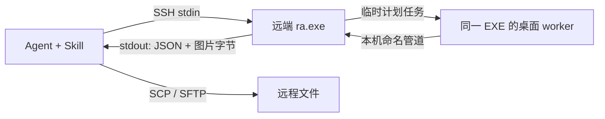

# Remote Windows SSH Skill

**通过 SSH 部署单文件 helper，让 AI Agent 操作远程 Windows 桌面的 Skill。**

把文件传过去、运行程序、查看界面、点击和输入，再把结果带回来。Remote Windows SSH Skill 采用 **C++ 单文件 helper + 纯 SSH + Skill**，让 Agent 复用已有的命令执行、文件传输和识图能力。

A skill and single-file helper for Windows desktop automation over plain SSH. One native executable, on-demand workers, no MCP server and no resident helper service.

[下载 0.4.0](https://github.com/xienan2010/remote-windows-ssh-skill/releases/tag/v0.4.0) · [详细用法](docs/USAGE.md) · [协议](skills/remote-windows/references/protocol.md) · [实测范围](docs/TEST_RESULTS.md) · [MIT License](LICENSE)

## 为什么做这个

Agent 已经擅长用 SSH 管理 Linux，但 Windows 软件经常需要图形界面：安装器、配置窗口、测试工具和只有桌面入口的程序。Remote Windows SSH Skill 把这部分能力补进现有 SSH 工作流。

例如，你可以让 Agent 将测试包上传到一台 Windows 电脑，在桌面启动程序、填写配置、观察结果，然后下载日志。多台电脑继续使用现有 SSH 名称，无需给每台电脑单独配置 MCP，也无需在每台电脑运行一个完整的 AI Agent。

## 特点

- **沿用 SSH。** 命令执行使用 SSH，文件使用 SCP/SFTP，桌面请求也走同一条 SSH 路径。按已有 Host 别名选择电脑，例如 `win-test`、`build-pc`。
- **远端只有一个原生 EXE。** C++17、静态链接 MSVC 运行库，不要求远端安装 Python、Node、.NET 或 Visual C++ Redistributable。
- **由 Agent 部署和更新。** 首次开通 SSH 后，脚本负责上传 helper、校验 SHA256 并替换版本；内容相同就复用。
- **按需工作，结束退出。** 使用 Windows 任务调度器启动短期桌面 worker，不安装额外常驻服务，不需要持续保持 RDP 连接。
- **截图与 UIA 配合。** 枚举窗口、读取 UI Automation、PNG/JPEG 截图、鼠标键盘和 Unicode 输入、GUI 程序启动及动作批处理。
- **一次响应带回图像。** 标准输出返回一行 JSON，后接原始图片字节；无需 Base64，也无需再连一次取图。Agent 使用自身的图片工具查看本地结果。
- **按需高权限。** 已具备管理员权限的 SSH 调用端可以为单次操作请求高权限 worker；默认操作仍使用普通 worker。
- **实验性的登录与解锁。** Windows 11 同一本地账户的标准密码界面，支持通过临时 SYSTEM worker 在注销／开机后登录，或解锁已有桌面；不配置持久自动登录。
- **可供不同 Agent 使用。** Skill 描述 Codex、Claude Code、DeepSeek Harness 的图片读取入口；协议不绑定模型提供商。完整端到端验证目前在 Codex 完成。

## 当前要求

| 位置 | 要求 |
| --- | --- |
| 控制端 | Agent 的 Shell 工具、SSH/SCP、**已有 PowerShell 7**；识图操作需要可用的图片工具和视觉模型 |
| 被控端 | 已开通 SSH、可用账户与网络；当前完整实测为 Windows 11 x64 |
| 普通桌面操作 | 同一 SSH 账户已登录且解锁，存在有效显示输出 |
| 高权限／登录／解锁 | SSH 调用端已具备管理员高完整性权限；登录和解锁还需已知 Windows 账户密码 |

当前随包控制端脚本验证的是 **Windows + PowerShell 7**。不需要安装专用本地客户端、MCP 或编译环境；控制端缺少 PowerShell 7 时，需要先自行准备。macOS/Linux 控制端可以实现相同协议，但本仓库尚未提供并验收对应接收脚本。

## 快速开始

### 1. 下载完整发布包

从 [Releases](https://github.com/xienan2010/remote-windows-ssh-skill/releases) 下载 **`remote-windows-ssh-skill-0.4.0.zip`** 并解压。GitHub 自动生成的 Source code 压缩包不包含预编译 EXE。

发布包包含 `windows-x64/ra.exe`、`windows-x86/ra.exe`、`SHA256SUMS.txt`、完整 Skill 和使用文档。优先在 x64 系统使用 x64 helper，执行前核对校验文件。

### 2. 安装 Skill

把完整的 `skills/remote-windows` 目录安装到当前 Agent 的技能目录，保留其中的 `scripts` 和 `references`，不要只复制 `SKILL.md`。也可以把仓库链接或本地发布包交给 Agent：

> 请阅读 <https://github.com/xienan2010/remote-windows-ssh-skill>，将 remote-windows Skill 安装到你的技能目录，按 Skill 的固定版本下载并校验 helper。之后通过 SSH 使用它操作我的 Windows 测试机。

Skill 自带固定版本发布地址和 EXE 校验值，可在只有 Skill 的情况下取得匹配 helper。下载与远端部署使用现有 PowerShell、SSH/SCP，不引入 MCP。

安装目录取决于 Agent 宿主：当前 Codex 官方用户级目录为 `~/.agents/skills/`，Claude Code 为 `~/.claude/skills/`；DeepSeek Harness 使用其当前版本支持的 Skill／说明加载方式。已有 Codex 安装可能使用 `~/.codex/skills/`，选择当前实际识别的位置即可，避免重复安装同名 Skill。[Codex 安装说明](https://learn.chatgpt.com/docs/build-skills) · [技能目录参考](https://developers.openai.com/api/reference/cli)

### 3. 连接并部署

下面的 `win-test` 是你自己的 SSH Host 别名，也可以直接使用 `user@host`。先确认普通 SSH 可以连接；以**解压后的发布包根目录**为当前目录运行：

```pwsh
ssh win-test whoami

& ./skills/remote-windows/scripts/Deploy-Ra.ps1 `
    -Computer win-test -Executable ./windows-x64/ra.exe

& ./skills/remote-windows/scripts/Receive-Ra.ps1 `
    -Computer win-test -Request '{"op":"status"}'

& ./skills/remote-windows/scripts/Receive-Ra.ps1 `
    -Computer win-test -Request '{"op":"windows"}'
```

helper 默认部署到远端 SSH 用户目录的 `RemoteAgent/ra.exe`。`ra.exe`、部署目录和内部任务／管道前缀沿用早期原型名称，以兼容已有部署。部署流程会检查远端 PowerShell 7，缺少时自动全局安装经过 SHA256 和微软签名校验的官方 MSI；安装包在控制端缓存。使用 `-SkipPowerShell` 可只部署 helper，原生 helper 本身不依赖 PowerShell。

认证由原生 SSH 处理。无人值守的多次调用需要已经可用的 SSH 密钥或其他认证机制；Skill 不内置密码、密钥或电脑清单。

### 4. 观察和操作

从 `windows` 的结果选取真实 HWND，再观察目标窗口：

```pwsh
& ./skills/remote-windows/scripts/Receive-Ra.ps1 `
    -Computer win-test -Request '{"op":"observe","params":{"window":123456}}'
```

接收脚本输出结构化结果和本地图片绝对路径 `image_path`，Agent 用自己的图片工具打开。动作可合并成一次请求，并在结束时带回新截图：

```pwsh
$request = @{
    op = 'act'
    params = @{
        window = 123456 # 替换为刚刚观察到的 HWND
        actions = @(
            @{type='focus'},
            @{type='click'; x=200; y=200},
            @{type='type'; text='中文测试'},
            @{type='key'; keys='Ctrl+S'}
        )
        observe = $true
    }
} | ConvertTo-Json -Depth 12 -Compress
& ./skills/remote-windows/scripts/Receive-Ra.ps1 -Computer win-test -Request $request

scp './test-package.zip' 'win-test:RemoteAgent/test-package.zip'
scp 'win-test:RemoteAgent/result.log' './result.log'
```

Agent 应根据实际截图或 UIA 结果选择控件和坐标。超时或断线后先观察状态再决定下一步，不自动重放可能已经完成的输入或程序启动。

## 如何跨越 SSH 与桌面会话



Windows SSH 进程通常在 Session 0；桌面在另一会话。helper 按需进入正确会话执行，并把结果送回当前 SSH 标准输出。普通、高权限和 SYSTEM 路径仍使用同一个 EXE；任务和 worker 在请求结束后清理。系统自带的 SSH 服务和任务调度器仍然是前提。

## 兼容性与边界

- **当前被控端是 Windows。** Windows 11 x64 已实测，x86 helper 也在同一 x64 系统上验证。Win7 SP1／Server 2008 R2 SP1 是编译兼容目标，旧系统、Win10 和真正的 32 位 Windows 尚未实机验收；实验性登录只面向 Windows 11。
- **本地控制台不需要 RDP 常连。** 没有物理显示器仍可存在桌面，但截图和坐标输入需要显卡、虚拟机、虚拟显示或显示假负载提供有效输出；物理拔屏场景未验收。RDP 断开／最小化需要另外处理。
- **登录不是通用凭据提供程序。** 当前仅验证同一 SSH 本地账户的标准已选账户密码界面；PIN／Hello／MFA、复杂账户切换、强制 Ctrl+Alt+Del 和新用户引导未全面支持。不提供通用安全桌面点击接口。
- **权限来自已有账户。** 高权限和 SYSTEM worker 要求调用端已具备相应管理员权限，不改变 UAC、SSH 默认 shell、WinRM 或持久自动登录配置。
- **识图能力来自宿主。** Codex 使用原生图片工具，Claude Code 使用 `Read`，DeepSeek Harness 取决于当前图片工具与模型路由。后两者尚未单独端到端验收；文本路径或 Base64 不等于图像已经送进模型。

更多命令、登录／解锁、PowerShell 缓存及故障处理见 [详细用法](docs/USAGE.md) 和 [Skill](skills/remote-windows/SKILL.md)。

## 开发

C++17、MSVC 2019+、Windows SDK、CMake 3.15+。提供的构建脚本使用 VS 2019 和 SDK 10.0.19041；其他版本可直接用 CMake，见 [贡献说明](CONTRIBUTING.md)。

```pwsh
& ./scripts/Build.ps1
& ./scripts/Build.ps1 -Architecture Win32
& ./scripts/Package.ps1
```

已完成真实 SSH 桌面操作、UIA、中文输入与保存、SCP、普通／高权限 worker、显示关闭后的密码解锁，以及注销／真实重启后登录测试。具体项目与未验证范围见 [验收记录](docs/TEST_RESULTS.md)。CI 构建两种架构并运行单元测试，远程桌面验收需自己的测试机。

## 许可证

Remote Windows SSH Skill 的源码、脚本和 Skill 使用 [MIT](LICENSE) 许可证。内嵌的 nlohmann/json 使用其自己的 MIT 许可证，见 [第三方声明](third_party/README.md)。PowerShell MSI 从微软官方发布获取并单独缓存，不包含在本项目发布包中。
