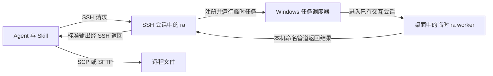

# Remote Windows SSH Skill 实现方案

> 2026-11-06（0.4.0）：追加 Windows 11 本地账户开机后／注销后按需登录；默认部署流程接入可缓存的全局 PowerShell 7 MSI 安装。已做真实注销、重启和缺失安装验证。初版范围保留作历史设计，当前能力以 README、协议和 TEST_RESULTS 为准。

> 2026-11-06：按后续授权新增 0.3.0 临时 SYSTEM 密码解锁原型和可选的全局 PowerShell 7 MSI 部署。本文初版的未实现范围是历史设计；最新能力、边界和实测结果以 README 与 TEST_RESULTS 为准。未增加常驻服务或持久自动登录。

日期：2026 年 11 月 3 日

状态：已进入实现，已在 win-test 完成核心 SSH/桌面实测；现状与限制见 [TEST_RESULTS.md](TEST_RESULTS.md)

采用 **C++ + 纯 SSH + 远程 helper + Skill**。控制端沿用 Agent 已有的命令执行和图片读取能力，不安装 RemoteAgent 客户端、MCP 或额外运行库。被控端由用户首次开通 SSH；之后由 Agent 检查环境、上传和更新 helper、执行操作、传输文件并读取结果。

首版面向 Windows 桌面，兼容 Codex、Claude Code 和 DeepSeek Harness。远程只分发一个 `ra.exe`，通过命令行接收请求、通过标准输出返回结果。桌面操作按需进入已登录用户的交互会话执行，完成后退出。

## 使用边界

| 项目 | 首版约定 |
| --- | --- |
| 控制端 | 已有 Agent、Shell、OpenSSH 客户端，以及 Agent 的原生图片读取工具 |
| 被控端首次准备 | 开通 OpenSSH Server，提供可用账户和网络连接 |
| 认证 | 复用 Windows 本地或 AD 账户；无人值守使用已配置的 SSH 密钥 |
| 远程 helper | C++ 单个 EXE，由 Agent 自动上传，不要求用户手工安装 |
| 运行依赖 | 使用 Windows 自带接口，C/C++ 运行库静态链接 |
| 桌面前提 | SSH 账户与图形登录账户相同，存在已登录且可操作的桌面 |
| 进程生命周期 | 每次请求按需启动桌面 worker，完成后退出，不设开机常驻进程 |
| 多电脑选择 | 使用现有 SSH Host 别名或用户指定的地址，不建立另一套电脑注册中心 |

“控制端不装额外工具”以已有 SSH 客户端和 Agent 为前提。Skill 可以附带调用已有 Shell 的薄脚本，但不引入本地 `ra` 客户端、Python、Node、jq 等新增前置依赖。不因为缺少某个可选工具而自动安装一套运行环境。

首次开通 SSH 需要在目标电脑本地、RDP 或其他已有管理通道中完成；无法通过尚未开通的 SSH 安装 SSH。后续 helper 部署不依赖被控端访问互联网。

## 架构与一次调用



SSH 中的进程具有用户身份，但不一定处于该账号已经登录的图形会话。同一账号的 SSH 登录与桌面登录不能视为同一个桌面。Windows 的窗口站属于相应会话，桌面执行必须选中正确会话。[Windows 窗口站说明](https://learn.microsoft.com/en-us/windows/win32/winstation/window-stations)

一次桌面请求按以下顺序处理：

1. Agent 通过 SSH 启动远程 `ra.exe`。
2. `ra` 识别调用者身份，查找同一用户的可用交互会话。
3. 无图形登录、桌面锁定或存在多个无法唯一选择的会话时，返回明确错误。
4. 当前进程已处于正确桌面时直接执行；否则创建本机命名管道和临时计划任务。
5. 临时任务使用 `TASK_LOGON_INTERACTIVE_TOKEN`，在该用户已有的交互会话运行同一个 EXE 的内部 worker 模式。`ra` 调用任务调度 COM 接口，不要求用户创建任务或提供额外的启动工具。
6. worker 连接管道，接收请求，执行操作并传回结果。父端收到 worker 握手后才确认桌面执行已就绪，不能只凭任务启动 API 返回成功作判断。
7. SSH 中的 `ra` 将结果写入标准输出，清理自己创建的临时任务；worker 退出。

`InteractiveToken` 只使用已经存在的交互会话。为本账户创建普通权限交互任务，在系统权限和策略允许时不需要额外保存密码，也不要求默认提权。[任务登录类型](https://learn.microsoft.com/en-us/windows/win32/api/taskschd/ne-taskschd-task_logon_type)、[任务权限规则](https://learn.microsoft.com/en-us/windows/win32/taskschd/security-contexts-for-running-tasks)

跨会话不能靠普通父子进程句柄继承自动接通标准输出，因此由 worker 通过命名管道回传，再由 SSH 中的 `ra` 输出。这只是同一台 Windows 内的进程通信，不增加网络端口、网络认证或第二条 SSH 连接。[跨会话句柄限制](https://learn.microsoft.com/en-us/windows/win32/api/processthreadsapi/nf-processthreadsapi-createprocessasuserw)

管道仅用于本机，按调用用户 SID 设置访问权限。SSH 登录与图形登录的登录会话可能不同，不能误用仅允许某个登录会话访问的权限设置。请求、任务和管道使用唯一标识；正常结束及时清理，异常残留也只清理本工具创建的资源。

## C++ 与系统兼容

使用现有 Visual Studio 2019 Build Tools、v142 工具集和 Windows SDK 构建。Release 使用 `/MT`，将 C/C++ 运行库静态链接到 EXE；系统接口依赖 Windows 自带 DLL。[运行库链接选项](https://learn.microsoft.com/en-us/cpp/build/reference/md-mt-ld-use-run-time-library?view=msvc-170)

| 目标 | 首版安排 |
| --- | --- |
| Windows 10 1809 及以上、Windows 11 x64 | 优先实施和验收的环境 |
| Windows 7 SP1、Server 2008 R2 SP1 及以上旧系统 | 兼容设计目标，逐版本实测后列入支持范围 |
| Windows Server 图形桌面版本 | 使用相同架构，按实际可用版本验收 |
| 32 位 Windows | 保留独立 x86 构建路径，是否纳入首批交付取决于目标环境 |
| 64 位 Windows 中的 32 位应用 | 纳入桌面操作验收，不能与 32 位操作系统支持混为一谈 |
| XP、Server 2003、Windows ARM64 | 不纳入首版 |
| Linux、macOS | 沿用 SSH 的管理方式；原生桌面 helper 不在 Windows 首版范围内 |

实现优先使用旧系统已有的 Win32、GDI、WIC、COM、Task Scheduler 和 UI Automation 接口。较新的 DPI 等 API 使用运行时能力检测和兼容路径；仅设置编译宏不能证明旧系统可运行。helper 与 OpenSSH 安装包分别验证兼容性，不能假定最新版 SSH 包适用于全部旧系统。

使用 RAII 管理句柄、COM 引用、内存和 GDI 资源；采用成熟的 JSON 实现并固定依赖版本。编译时依赖随工程管理，不转化为目标机器的运行库安装要求。不引入大型 GUI、插件或网络框架。

## 首次开通 SSH 与自动部署

首次初始化只负责让目标电脑可通过 SSH 访问，不把 helper 安装纳入用户的手工步骤。

- 已有可用 OpenSSH Server 时直接复用，不更换它的配置或安装方式。
- Windows 10/11 可安装系统可选组件；组件获取受阻时，可以改用经过验证的 Win32-OpenSSH 独立 MSI。切换安装方式前先让当前组件安装正常结束或取消。
- 开通时启用 `sshd`、确认入站规则和账户可登录，推荐为自动化配置密钥。安装服务通常需要管理员权限，日常 helper 操作使用普通账户权限。

系统可选组件安装涉及 Windows Update、WSUS、网络和组策略，不能把下载缓慢直接归因于 SSH 本身。独立发行版采用另一条安装路径，后续更新也需单独维护。[组件安装问题](https://learn.microsoft.com/en-us/troubleshoot/windows-server/system-management-components/cant-install-openssh-features)、[MSI 安装方式](https://github.com/PowerShell/Win32-OpenSSH/wiki/Install-Win32-OpenSSH-Using-MSI)

SSH 可用后，Agent 按以下流程自动部署：

1. 使用用户给出的地址或现有 Host 别名建立连接，复用已有认证和 SSH 配置。
2. 检测 Windows 版本、架构、用户目录，以及已有 helper 的版本和能力。
3. 选取匹配架构的预编译发布包，在控制端取得固定版本文件并核对发布校验值，通过 SCP/SFTP 上传。目标机器不需要编译器或互联网连接。
4. 默认放入用户目录下的 `.remoteagent/versions/<版本>/ra.exe`，不修改系统 PATH，不要求写入系统目录。实际绝对路径由环境探测确定，并按目标 Shell 正确转义。
5. 调用状态命令，检查协议、桌面会话和能力；只有需要桌面操作时才启动临时 worker。
6. 后续发现兼容版本已存在时直接复用，不重复上传。升级写入新版本目录，不覆盖正在运行的 EXE；本次调用使用明确版本路径。

任务结束后保留可复用的 helper 文件；每次请求创建的进程、管道和任务应回收。用户要求移除时，Agent 清理本工具的文件和残留任务，保留 OpenSSH、用户应用和测试数据。

## 命令与结果约定

以下是待实现的接口约定，不表示这些命令目前已经可运行。示例使用 `C:/Tools/ra.exe` 简化路径，实际部署到用户目录。

| 操作 | 用途 |
| --- | --- |
| `status` | 返回版本、协议、账户、会话和能力，不要求一定存在可操作桌面 |
| `windows` | 列出目标会话中的可用窗口 |
| `observe` | 返回指定窗口或显示器的截图、几何信息和有界的 UIA 摘要 |
| `act` | 顺序执行点击、双击、拖动、输入、快捷键、滚动、UIA Invoke/SetValue 和短时等待；可附带最后一次观察 |
| `launch` | 在用户图形会话启动程序，返回 PID；worker 退出后目标程序继续运行 |
| `call` | 从标准输入读取 JSON 请求，供 Agent 稳定调用上述同一套操作 |

公开命令不暴露 worker 和任务调度细节。Agent 默认采用固定的 `call` 入口，将路径、中文和动作参数放入标准输入，减少多层 Shell 引号问题。命令行参数和 JSON 请求使用同一分发逻辑，不维护两套行为。

示例入口：

```text
ssh -T win-test "C:/Tools/ra.exe status"
ssh -T win-test "C:/Tools/ra.exe call"
```

第二条命令由 Skill 配套的接收流程同时提供标准输入，不是让 Agent 等待人工输入。普通后台命令、脚本和文件管理直接使用 SSH/SCP/SFTP；需要出现在桌面的程序使用 `launch`。

### 标准输入与输出

首版每次 `ra call` 处理一个 JSON 请求，支持请求内动作批处理。请求包含协议主版本、请求 ID、操作名称、参数和超时。较长的测试通过启动程序、后续观察和读取日志完成，不长期占用一个桌面 worker。

标准输出采用**一行 UTF-8 JSON 结果头，随后为已声明长度的原始图片字节**：

- 结果头包含协议版本、请求 ID、`ok`、结构化结果、错误信息，以及图片类型和字节长度。
- 无图片时图片长度为零，输出只包含结果头。
- 有图片时接收方按字节长度收取 PNG/JPEG，不将图片作为文字处理；原始尺寸、截图原点、窗口和显示器信息放在结果头中。
- 标准错误仅输出诊断日志，退出码区分成功和失败。部分动作已完成时返回完成列表和失败位置，不声称整批操作原子执行或已经回滚。
- Windows 端标准输入输出使用二进制模式；SSH 使用 `-T`，避免 PTY 和文本换行转换破坏图片。

这只是命令结果的轻量格式，不引入 HTTP、WebSocket、RPC 框架或 MCP。图片无需 Base64 编码，也不直接回显到模型上下文。

### 请求与状态寿命

首版采用每次命令建立 SSH 连接、按需创建桌面 worker 的方式，不增加控制端后台服务或连接池。一次 `act` 可以执行多个确定动作并返回最终截图，减少 SSH 和模型往返。

不依赖跨请求的 Shell 状态、COM 指针或进程内缓存。UIA 结果提供可序列化的窗口信息和元素定位信息，后续操作重新定位和校验；临时元素编号只在同一请求中使用。定位不到或匹配不唯一时重新观察，不操作近似目标。

## 桌面能力与故障处理

截图先实现 GDI 捕获和 WIC PNG/JPEG 编码，默认保持可读文字和明确坐标关系。支持指定窗口或显示器，避免每次发送巨幅多屏截图。游戏测试先使用窗口模式实测；具体任务出现 GDI 黑屏时，再评估 DXGI 捕获，不预先实现多个后端。

输入使用 `SendInput`，文字优先使用适用的 UIA 设置值或 Unicode 输入。窗口操作确认目标身份和激活结果；输入注入成功不等于应用已经完成业务操作，需通过后续观察或文件、日志验证结果。普通权限不能保证向高权限应用注入输入，也不覆盖 UAC 安全桌面。[SendInput 限制](https://learn.microsoft.com/en-us/windows/win32/api/winuser/nf-winuser-sendinput)

UIA 在正确初始化的 COM MTA 线程上运行，限定窗口范围、扫描节点数和时间。每次请求的 worker 本身就是隔离边界；UIA 卡住时结束本次 worker，不再额外引入一层长期 UIA 服务。能取得截图而 UIA 不可用时返回截图和原因，不能把空树伪装成完整结果。[UIA 线程要求](https://learn.microsoft.com/en-us/windows/win32/winauto/uiauto-threading)

必须处理以下直接影响操作正确性的情况：

| 情况 | 行为 |
| --- | --- |
| 没有同账户图形登录 | `NO_INTERACTIVE_SESSION`，提示先登录 |
| 桌面已锁定或会话不可操作 | 返回锁定或断开原因，不自动登录、解锁或切换用户 |
| 多个候选交互会话 | 返回歧义信息，要求明确会话，不随意选择 |
| 任务注册、启动或桌面访问被拒绝 | 返回权限或策略错误，不能误报为用户未登录 |
| 控件、窗口或截图几何信息失效 | 返回 `STALE_TARGET`，要求重新观察 |
| UIA 失败或超时 | 返回可用的截图与警告；必要时结束本次 worker |
| 两个调用同时操作同一桌面 | 用本机互斥机制串行化整个动作批次，等待超时返回繁忙，不交错输入 |
| SSH 断线且动作结果未知 | 返回或在下次诊断中明确结果不确定；不自动重放点击、输入、启动等有副作用的操作 |

坐标统一使用物理像素，明确截图原点、裁剪与缩放映射；覆盖 DPI 缩放和多显示器负坐标。按键或鼠标按下后，在失败路径中释放。超时和取消只回收本次任务与 worker，不误杀目标程序或其他用户进程。

`launch` 必须验证目标程序能独立存活：临时任务结束、worker 回收或 SSH 断开，不应连带结束已启动的测试程序。任务调度器的作业约束和所选启动方式在最小原型阶段一起验证。

## Skill 与三个 Agent

共享一份工作流程和远程命令契约，以少量宿主说明适配工具名称。Skill 通过各 Agent 现有的技能加载方式使用，不修改其源码、模型路由或工具注册配置。Skill 可以携带调用既有 Shell 的薄脚本，不形成另一个需要安装的产品。[Skill 结构](https://learn.chatgpt.com/docs/build-skills)

Skill 的工作顺序为：识别目标 SSH 主机，检查认证和 helper，必要时上传，检查桌面状态，执行操作，接收结果和截图，使用原生读图工具观察，然后决定下一步。

| Agent | 图片读取入口 |
| --- | --- |
| Codex | 当前可用的 `view_image` 或等效原生图片工具 |
| Claude Code | `Read` |
| DeepSeek Harness | `read_image`，当前模型路由须支持图像输入 |

Codex 和 Claude Code 已有本地图片读取能力；DeepSeek Harness 的 `read_image` 依赖附件服务和图像能力路由。Skill 以当前暴露的工具为准，不假定所有模型都能看图。[Codex 图片工具](https://developers.openai.com/cookbook/examples/gpt-5/codex_prompting_guide)、[Claude Code 图片读取](https://code.claude.com/docs/en/tools-reference#read-tool-behavior)、[DeepSeek Harness 工具目录](https://github.com/deepseek-ai/deepseek-harness/blob/master/docs/tool-catalog.md)

控制端接收逻辑使用已有 Shell 和系统能力分离结果头与图片，生成本地临时图片，返回小体积状态和图片绝对路径。Windows 控制端通过已有 PowerShell 的进程和字节流能力接收，不能依赖旧版文本重定向保持二进制；POSIX 控制端使用现有 Shell 和字节流命令。不得强制安装 Python、Node 或 jq。

首版正式验收以当前 Windows 控制环境为先；其他控制端系统采用相同 SSH 契约，其接收路径需分别验证后再承诺支持。接收代码应作为 Skill 附件或等效调用说明提供，Agent 不必每次重新编写。

通用流程接受“执行 SSH 并接收图片，再调用原生图片工具”两步。终端中的 Base64、文件名或图片预览不能代替模型的原生图像输入。宿主已有程序化工具时可以合并步骤，但不为此改造 harness 或注册 MCP。

## 实施顺序与验收

### 第一阶段 验证桌面执行链路

用最小原型验证：SSH 普通用户发起调用，任务调度器在同账号已有桌面启动临时 worker，截图经命名管道回到 SSH 标准输出并保存为可打开的图片。验证未登录、锁屏、权限拒绝、超时和清理行为；同时确认图形程序能在 worker 退出后继续运行。

这条链路通过后再展开完整功能。若目标机器的策略不允许该启动方式，明确记录约束，不悄悄扩大权限、安装常驻服务或要求用户手工管理 worker。

### 第二阶段 完成 helper 核心能力

完成窗口枚举、截图、输入、程序启动、UIA、动作批处理、结果格式、目标校验和资源管理。使用小型单元测试覆盖结果格式、坐标映射和错误分类；桌面行为以真实 Windows 交互测试为准。

### 第三阶段 完成自动部署与 Skill

提供固定版本发布文件、校验值、部署和更新说明、接收结果的 Skill 附件，以及三个 Agent 的图片工具适配。验证已有 SSH 别名、中文和空格路径、重复部署与版本不兼容的行为。

### 第四阶段 端到端验收

三个 Agent 分别完成同一流程：通过 SSH 检测目标，自动上传 helper 和测试文件，启动远程记事本，输入并保存中文，读取 UIA 和截图，再将文件下载回来核对内容。另行验证现有 helper 的复用与更新。

桌面验收至少覆盖 DPI 缩放、多屏坐标、32 位目标应用、UIA 不可用、连接中断和重复调用。之后执行传奇服务器的真实流程：上传测试包、启动图形程序、操作配置、观察结果、下载日志，并验证服务器程序不因 worker 或 SSH 退出而结束。旧系统在可用测试环境中逐版本验收。

图片格式、请求解析和模拟结果不能代替真实的跨会话、截图、点击和中文输入验收。发布的兼容表只列出已经通过相应验收的系统、架构和 SSH 组合。

## 首版交付与范围

交付预编译 `ra.exe`、发布校验值、共享 Skill、三个 Agent 的简短适配说明、SSH 首次初始化指南，以及真实环境验收记录。

首版不实现本地专用客户端、MCP、独立网络服务、网关、设备发现、连接池、视频流、多 Agent 调度、自动登录解锁或跨用户桌面控制。远程任务计划和 worker 均由命令自动管理，用户的日常入口保持为现有 Agent 和 SSH。

本文保留最初批准的实施范围。用户随后已授权代码实现、helper 部署和远程测试；不再受原“仅整理方案”阶段边界限制。实现与已验证范围以 README 和 TEST_RESULTS.md 为准。
