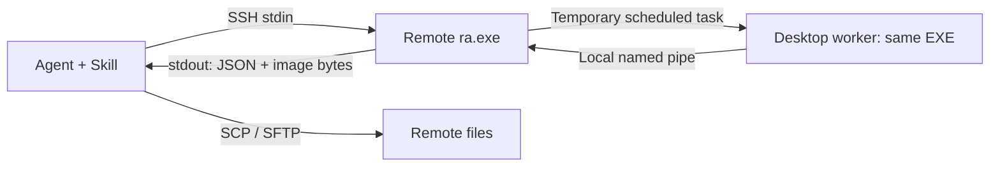

# Architecture and implementation

**English** | [简体中文 / original design](IMPLEMENTATION_PLAN.zh-CN.md) · [README](../README.md)

SSH Remote Desktop combines an agent Skill, ordinary SSH/SCP and one native
Windows executable. Current release: **0.5.0**, wire protocol **1**. The original
2026-11-03 design and later implementation notes are preserved in the Chinese
document; this page describes the delivered architecture.

## One request

1. The agent chooses an existing SSH host and starts the front-end helper.
2. The helper selects the correct same-account graphical session. Normal GUI
   calls require an active, unlocked desktop; login selects the current console.
3. Windows Task Scheduler starts a short-lived worker from the same executable
   in that session. Ordinary requests use ordinary-worker policy; explicit
   elevated requests require an already elevated caller.
4. The worker performs UIA, screenshot, input or launch operations and returns a
   structured result and optional image through a protected local named pipe.
5. The front end writes one JSON header and raw image bytes to SSH stdout. The
   controller saves the image for the agent's native image reader. The request's
   workers, task registrations and temporary staging are cleaned up.

SSH identity and graphical-session identity are different concepts. Windows SSH
usually runs in Session 0, so an SSH child does not automatically see the user's
interactive desktop. The temporary worker bridges those sessions; it does not
require another EXE, a permanently running bridge or a separate listening port.

## Implementation choices

- C++17, Win32/UI Automation and static MSVC `/MT` runtime; Windows DLLs only.
- A GUI-subsystem EXE with explicit Win32 stdin/stdout handles, avoiding an
  extra console window while retaining a CLI request/response contract.
- JSON on stdin, bounded action batches, request deadlines and explicit errors
  for stale targets, unavailable sessions and insufficient permissions.
- Raw PNG/JPEG bytes after the JSON header; SSH compression/Base64 is not part
  of the protocol. Native SSH handles encryption and authentication.
- SSH/SCP for ordinary programs and files; the helper is used for GUI work.
- A generic Skill and host-specific image-tool guidance instead of MCP wiring
  or changes to the agent's default tool behavior.

## On-demand SYSTEM path

Password login/unlock and secure-desktop diagnostics use the same executable,
temporarily staged in an administrators/SYSTEM-only writable directory. An
elevated caller creates a short-lived SYSTEM scheduler task. Its launcher uses
the target session's Winlogon SYSTEM token to create the worker on the appropriate
desktop; it does not inject code into Winlogon or install a credential provider.

The front end verifies the pipe client's PID, account and session before sending
credentials. A kill-on-close job bounds the worker lifetime. Password submission
is single-attempt, and success requires the actual WTS account/session and an
unlocked Default desktop. Unsupported login layouts return a specific error.

## Deployment and compatibility

Version 0.5.0 adds optional [headless display setup](HEADLESS.md): the SSH front
end performs a pinned machine-wide driver installation through native SetupAPI;
an existing temporary SYSTEM console worker queries and persists display topology.
The controller caches and uploads the driver-only package over SSH/SCP. No new
helper executable, custom service, control panel or transport is introduced.
The optional UMDF driver remains loaded by Windows while enabled, independently
of per-request workers. Existing usable displays and other vendors' devices are
preserved unless a topology change is explicitly requested.

The Skill installs on the controller once. It obtains its pinned release,
verifies the helper hash and uploads it to the existing remote user directory.
Identical binaries are reused. Remote PowerShell 7 can be installed globally
from a controller-cached, verified Microsoft MSI; the helper itself needs no
PowerShell runtime.

Since 0.4.2 the Skill is named `ssh-remote-desktop`, matching the project. Replace
an older `remote-windows` Skill folder when upgrading. The `ra.exe` command,
`RemoteAgent` directory and internal task/pipe prefixes remain compatible with
earlier deployments. No MCP, WinRM,
SSH default-shell modification, resident helper service or persistent auto-login
configuration is introduced.

Windows 11 x64 is the validated target. x86 helpers have been tested on that
x64 OS; old Windows and true 32-bit Windows are not established by a successful
build. See [validation](TEST_RESULTS.md) and [advanced usage](USAGE.md).
