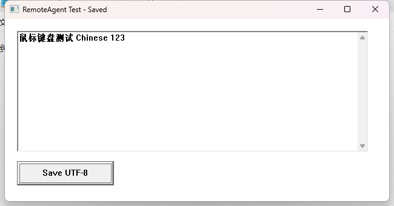
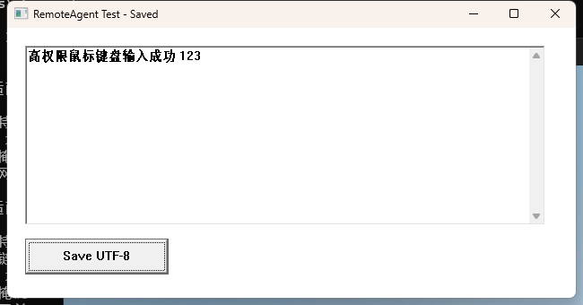

# Validation and current limits

**English** | [简体中文 / detailed test history](TEST_RESULTS.zh-CN.md) · [README](../README.md)

Current release: **0.4.2**. The desktop implementation was validated through
0.4.0; 0.4.1–0.4.2 change branding, Skill naming, version metadata and documentation, without changing
desktop behavior. Its binaries are rebuilt and unit-tested. The Chinese history
preserves version-by-version test details from 2026-11-03 through 2026-11-06.
Hostnames, addresses and user names in public examples are documentation values.

## Environment

| Component | Tested environment |
| --- | --- |
| Target | Windows 11 x64, builds 10.0.26200.6584 and 10.0.26200.9711 across test rounds |
| Sessions | Same account over SSH in Session 0; initial RDP tests, then local Console tests without RDP |
| Controller | Windows, existing OpenSSH client and PowerShell 7 |
| Agent | Codex with shell and native image tools; no MCP configured |
| Build | MSVC 2019, SDK 10.0.19041, C++17, static `/MT`; x64 and Win32 |
| CI | Windows runner builds and unit-tests both architectures |

## Passed desktop and deployment checks

| Area | Observed result |
| --- | --- |
| Runtime dependencies | Only Windows system DLLs; no dynamic MSVCP/VCRUNTIME/UCRT dependency |
| SSH to desktop | Real cross-session request, temporary task, worker and named-pipe result return |
| Windows and images | HWND/PID/start time/bounds, PNG/JPEG size checks and actual image inspection |
| UIA and input | Control tree, unique selectors, SetValue/Invoke, mouse, shortcuts and Unicode input |
| Files and saving | SCP transfer, spaces/Chinese paths, Notepad save and downloaded-content comparison |
| GUI launch | Launched application remains available after its request worker and SSH exit |
| Stale target | Mismatched expected PID rejects input with `STALE_TARGET` |
| Partial batch | Stops at the failed action and does not execute later actions |
| UIA observation budget | Blocking test provider returns a usable screenshot with a timeout warning |
| Connection interruption | Receiver reports transport failure; no automatic replay; worker later exits |
| Update/reuse | Staged hash/version checks, replacement and `changed=false` for identical helper |
| High privilege | 20-check elevation suite; actual high tokens, ordinary requests remain medium |
| Ordinary regression | 18-check remote smoke suite |
| Password unlock | 15-check suite with x64 and x86 helpers; real Windows locked/unlocked state verified |
| Display-off unlock | 15-check suite after an API-requested display power-off; no RDP connection |
| Logout login | 20-check suite; new console session and the actual account SID verified |
| Reboot login | 21-check suite; real reboot, decreased uptime, SSH reconnect and initially empty console |
| x86 helper | Full logout/login suite on Windows 11 x64; not proof of native 32-bit Windows support |
| Missing PowerShell 7 | Actually uninstalled it, then globally reinstalled through CMD/MSI bootstrap |
| Installer cache | SHA256/Microsoft signature checks; cached MSI reused without another download |
| Cleanup | End-of-test counts: zero helper workers, tasks, protected staging directories or helper services |
| System settings | SSH DefaultShell unchanged; WinRM stayed Manual/Stopped; explicit SSH `pwsh` worked |

Actual fixture screenshots returned through helper → SSH → receiver:

Reproducible suites live under [tests](https://github.com/xienan2010/ssh-remote-desktop/tree/main/tests).
The login suite logs out or reboots its target; the unlock suite locks it. Run
those only when such disruption is intended. Raw results and authentication
test adapters stay outside release archives and source-control submissions.

## Not yet established

- Separate end-to-end runs inside Claude Code and DeepSeek Harness. Their image
  entry points are documented; actual vision support depends on the host/model.
- macOS/Linux desktop targets or dependency-free POSIX controller receivers.
- Windows 10, Win7 SP1/Server 2008 R2 SP1 or true 32-bit Windows. The legacy
  compilation target does not establish runtime compatibility.
- Complex account selection, PIN/Hello/smartcard/MFA, forced Ctrl+Alt+Del,
  new-profile onboarding or disconnected-RDP reconnection.
- Physically unplugged monitors, every display power state, mixed-DPI physical
  multi-monitor layouts or every vendor's UIA provider.

A queued input event is not application completion, a successful logon token is
not a graphical sign-in, and a stale screenshot is not proof of an unlocked
desktop. Login/unlock checks use Windows state. After unknown action outcomes,
observe before any explicit retry.
