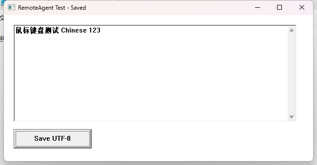
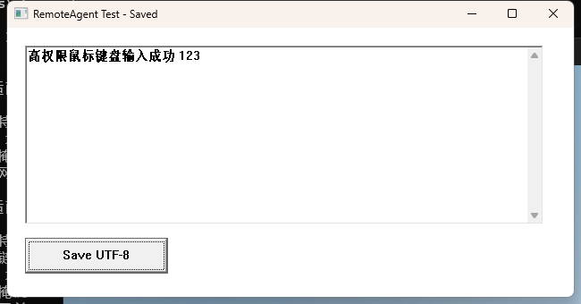

# SSH Remote Desktop 验收记录

[English](TEST_RESULTS.md) | **简体中文** · [返回 README](../README.zh-CN.md)

当前版本为 0.5.0。本文按版本保留实际测试记录；早期版本的限制属于当时的范围。主机名、地址和用户名已替换为文档示例，不将编译成功等同于旧系统支持。

## 0.5.0：拔掉全部显示线、无 RDP 的真实验收（2026-11-06）

用户确认拔掉全部 HDMI/DP 显示线并断开 RDP。测试机为 Windows 11 x64 build 26200，
AMD 显卡，已有 GameViewer 虚拟显卡保持安装。拔线后 Windows 起初仍保留旧物理屏路径并能截图，
默认 `ensure` 正确复用，没有多装驱动。随后显式切换到 **只有 VirtualDrivers 活跃显示路径**，
通过 QueryDisplayConfig 返回的 ROOT\DISPLAY 适配器路径和厂商标记确认截图来源。

- 固定的 VirtualDrivers 25.7.23 通过 helper 安装，无需重启即可提供 1 个 1920×1080 桌面。
- 无显示器部署 18 项检查通过：缺包提示、篡改文件在创建设备前拒绝、控制端缓存/离线包部署、
  同一 SSH 响应回图、重复调用不增加设备、禁用后按需重新启用。
- 普通 GUI 回归 18 项通过：PNG/JPEG、实际查看图片、UIA、鼠标键盘与中文输入、GUI 进程存活、
  中文及空格文件名 SCP 往返；重启恢复后再次通过。
- 重启与登录 25 项通过：uptime 证明确实重启、SSH 恢复、**首次图形登录前**虚拟显示和截图已恢复；
  一次密码提交后核对实际账户 SID、Default 桌面已解锁；登录后虚拟屏仍可用，普通 worker 仍是中完整性。
- 最终检查：helper worker、临时任务、驱动上传目录、受保护的临时目录、自定义 helper 服务均为 0。
  其他已有显卡保留，全局 PowerShell 7 复用。

为静默安装，将固定的 SignPath **叶证书**加入机器 TrustedPublisher，没有导入根证书。
本机 Secure Boot 原本为 **关闭**，未修改；开启 Secure Boot 和内存完整性策略的组合尚未验证，
没有启用测试签名或绕过签名策略。可选 UMDF 驱动启用期间由 Windows 持续加载；helper 无新增常驻服务。
配置、来源、移除方式见[无显示器说明](HEADLESS.zh-CN.md)。

## 环境

| 项目 | 实测环境 |
|---|---|
| 被控机 | win-test / 192.0.2.10，Windows 11 x64，系统版本 10.0.26200.6584 |
| 账户和会话 | SSH 账户 user；SSH helper 在 Session 0，同账户 RDP 图形桌面在 Session 1 |
| 控制端 | Windows，已有 OpenSSH_for_Windows 9.5p2、PowerShell 7.6.5 |
| 构建 | MSVC 19.29.30159，Windows SDK 10.0.19041，C++17，Release /MT；x64 和 Win32 |
| Agent | 当前 Codex 桌面会话，现有 shell / 本地图片读取工具；没有配置 MCP |

测试过程中未安装运行库或常驻服务，未修改远端 sshd、认证方式或安全策略。口令只用于原生 SSH 认证，不写入源码或发布包。为自动化测试构建的 SSH_ASKPASS 程序仅存在于开发构建目录，不是产品依赖，也不分发。

控制端追加了 `~/.ssh/config` 中的 `win-test` Host 别名，指向 `192.0.2.10`、示例用户 user，复用该 IP 的已验证主机密钥；未保存密码或新增认证密钥。共享 Skill 已复制到当前 Codex 的 `~/.codex/skills/remote-windows`，通过该已安装路径执行 `-Computer win-test` 的 status 调用成功。远端已清理测试 EXE，只保留正式 helper 和测试生成的文本文件。

## 已通过

| 项目 | 观察到的结果 |
|---|---|
| x64 / x86 编译和 CTest | 两种架构通过；覆盖 UTF-8、协议、错误结果、超时参数、负坐标映射和 Windows 引号处理 |
| 运行库依赖 | `dumpbin /dependents` 只列出 Windows 系统 DLL，没有 MSVCP/VCRUNTIME/UCRT 动态运行库依赖 |
| SSH 到桌面 | 真实 Session 0 发起调用，临时任务在 Session 1 启动 worker，经命名管道回传结果 |
| 临时任务和 worker | 正常请求结束后无 RemoteAgent 计划任务或 ra.exe 常驻进程 |
| 自动更新和复用 | 上传新版本、远端 SHA256 核对、协议检查、替换；同一版本哈希一致返回 changed=false |
| GUI 独立存活 | 启动测试窗口后，worker 和 SSH 已退出；后续新 SSH 连接仍能枚举和操作该进程 |
| 窗口与截图 | HWND/PID/创建时间/物理边界；PNG/JPEG 二进制长度与文件一致，已用原生图片工具实际打开 |
| 鼠标、键盘、中文 | 点击、组合键、Unicode 输入；实际 UIA Value 与输入文本一致 |
| UIA | 读取控件树、唯一 AutomationId 定位、SetValue、Invoke；截图与 UIA 一次调用返回 |
| 32 位应用 | 最终 x64 helper 对 Win32 测试窗口的完整 smoke 流程通过；x86 helper 在该 x64 系统上完成跨会话窗口枚举 |
| 中文和空格路径 | 测试文本通过 SCP 下载并逐字符核对；helper 放入“中文 目录”后仍能启动 worker 并回传截图 |
| 失效目标 | 错误 expected PID 返回 STALE_TARGET，拒绝继续输入 |
| 部分批次失败 | 第一个动作完成、第二个动作无效时返回 failed_index=1，第三个输入动作未执行 |
| 无对应候选会话 | 指定不存在的 session_id 返回 NO_INTERACTIVE_SESSION；未通过注销真实用户来模拟 |
| 连接中断 | 10 秒 wait 批次中杀掉本次本地 SSH 子进程；接收端报失败，等待该批次结束后无 worker / 任务残留 |
| 阻塞 UIA 观察 | 测试窗口在 WM_GETOBJECT 中阻塞 8 秒；observe 约 3.8 秒返回 ok=true、可用 PNG 和 UIA 超时警告 |
| 记事本端到端 | 上传文本、SSH 启动真实 Windows 记事本、点击编辑区、中文输入、Ctrl+S 保存、SCP 下载后全文一致 |
| Skill | bundled quick_validate 校验通过；接收和部署附件在本次真实测试中使用 |

可复现的桌面 smoke 脚本为 [Remote-Smoke.ps1](https://github.com/xienan2010/ssh-remote-desktop/blob/main/tests/Remote-Smoke.ps1)，初版每次含 17 项检查，并可切换 x64 / x86 测试窗口。截图、JSON 和下载文件位于本地忽略目录 `.test-output`；不随发布包分发认证测试工具或临时数据。

以下图片为远端真实测试窗口，经 helper → SSH → 接收脚本返回的原始 PNG：

## 测试中修复的问题

1. 控制台子系统的 worker 会触发临时控制台遮挡画面。最终使用 Windows GUI 子系统和 Win32 标准句柄，保持 CLI 协议且不创建控制台窗口。
2. 任务调度器拒绝 CREATE_BREAKAWAY_FROM_JOB。增加同账户同会话桌面 shell 父进程路径，验证目标程序跨请求存活。
3. SSH 管理员令牌注册的任务，桌面普通令牌无法自删。注册时给本账户和 SYSTEM 明确权限，worker 在执行前删除任务注册，前台保留回收职责。
4. UIA provider 可能在单次 COM 调用内阻塞。只读观察改为有等待预算的独立 COM 线程，超时保留截图；线程随本次命令进程退出回收。

## 已知限制和待验证项

- 旧系统 Win7 SP1 / Server 2008 R2 SP1、Win10，以及真正的 32 位 Windows 系统尚无实机验收。x86 在 x64 上运行不等同于这些环境通过。
- Claude Code 和 DeepSeek Harness 已提供共享 Skill / 图片入口说明，但没有在这两个宿主中单独跑端到端任务。当前脚本依赖控制端已有 PowerShell 7；其他控制端接收路径未验收。
- 真实锁屏和未登录已在后续版本验收；RDP 断开重连、多用户同账户会话歧义、组策略拒绝及普通非管理员账户权限矩阵仍未完整实测。
- DPI 缩放和多屏负坐标的计算已有测试，但不同 DPI 的真实多屏桌面尚未验收。拖拽、滚轮、双击等已实现，未逐项做完整桌面回归。
- RDP 客户端最小化时曾出现 BitBlt 拒绝访问。不承诺最小化或断开的 RDP 会话可自动操作；0.5.0 的 VirtualDrivers 无显示器本地控制台路径已单独验收。
- GDI 是可见像素捕获，可能被其他窗口遮挡；现代应用处理一串输入和保存也可能晚于事件入队。截图若显示中间状态，应等待再 observe，不重放输入。文件保存测试另外通过下载全文核对。
- UIA 修改操作的 provider 阻塞仍由整个请求超时回收，结果可能未知；观察用的阻塞测试不能代替所有厂商 provider 的验收。
- 传奇服务端测试包未提供，因此本次验证的是相同技术链路与记事本工作流，未声称实际游戏服务端已测试。

发布包附带 x64/x86 EXE、SHA256SUMS、Skill 和使用文档。构建兼容目标与上述实测范围分别陈述。

## 2026-11-04 Skill 说明修正

根据用户的自动化要求，移除了将自动登录、确认或提权概括为一律禁止的措辞。用户授权内的普通软件登录和确认操作可继续执行；Windows 桌面登录/解锁、高权限 worker、安全桌面输入仍是当前 helper 尚未实现的能力。另已澄清本地已登录解锁且有显示输出的桌面不需要 RDP。本次仅修正说明和已安装 Skill，未新增相关 helper 命令，也未配置远端自动登录或更改其 UAC/登录设置。

上述“高权限 worker 尚未实现”描述的是当时的 0.1.0；后续按用户要求已实现以下 0.2.0 功能。

## 0.2.0 按需高权限验收（2026-11-04）

环境仍为 win-test / Windows 11 x64，本轮同账户交互桌面位于 Session 2。SSH 进程令牌为 high；普通任务 worker 实测 medium，显式请求的高权限 worker 实测 high。

实现增加 `params.elevated:true` / CLI `--elevated`，协议版本仍为 1，能力表新增 `elevated_worker`。高权限使用临时的 `TASK_RUNLEVEL_HIGHEST` 任务；调用端必须已有管理员高完整性权限。返回 `worker`、窗口及启动结果中的实际权限，按调用选择，不保留常驻高权限进程。

| 验证项目 | 结果 |
|---|---|
| x64 / Win32 Release 构建与 CTest | 均通过；新增默认普通、显式高权限、拒绝字符串冒充布尔值的请求测试 |
| x64 helper + x64 管理员测试窗口 | 高权限专项脚本 20 项检查通过 |
| x86 helper + x86 管理员测试窗口 | 在 Windows 11 x64 上同样通过 20 项检查，覆盖实际跨位数环境 |
| 默认权限 | 同一个高权限 SSH 登录发起普通请求，worker 为 medium |
| 显式高权限 | 返回的 worker 及目标程序令牌均为 high，窗口自身也显示 Elevated 标题 |
| 程序启动与独立存活 | 保留高权限令牌，worker / SSH 退出后程序仍存活；其后新连接继续操作成功 |
| 普通 worker 操作高权限窗口 | 输入前返回 ELEVATION_REQUIRED，无动作执行 |
| 高权限窗口操作 | PNG、UIA、SetValue、Invoke、鼠标点击、组合键、中文输入成功；下载保存的文件全文一致 |
| 权限不延续 | 高权限批次结束后再发普通请求，仍是 medium |
| 普通功能回归 | 窗口、截图、普通 UIA、鼠标键盘、文件传输、失效目标和部分批次失败检查通过 |
| 调用端权限不足 | 本机 medium 进程请求 elevated=true，明确返回 ELEVATION_REQUIRED，未启动 worker |
| CLI 与清理 | SSH 直接调用 windows --elevated 成功；请求结束无 RemoteAgent 临时任务或 ra.exe 残留 |

高权限启动在 shell 父进程回退路径中使用 `CreateProcessAsUserW` 显式保留 worker 令牌；新进程先以挂起状态创建，在恢复主线程前核对实际权限及会话。如果权限丢失会结束这次尚未运行的新进程并报错，不静默按普通权限执行。

普通模式回归时发现测试机存在高权限前台窗口，Windows 拒绝 medium worker 切换焦点。增加了对此类焦点失败的 `ELEVATION_REQUIRED` 诊断；回归脚本显式用高权限调用准备普通窗口的前台状态，其后的实际输入仍由 medium worker 执行。该问题与目标窗口本身是否高权限是两个不同的触发条件。

可复现脚本：[Remote-Elevation.ps1](https://github.com/xienan2010/ssh-remote-desktop/blob/main/tests/Remote-Elevation.ps1)，支持 `-FixtureExecutable` 和 `-RemotePath` 切换测试程序及 helper 位数。原始结果保存在 `.test-output/elevation-summary.json`、`elevated-observe.json`；以下为回传的真实截图：

本轮同步更新仓库 Skill、协议说明、本机 Codex 已安装 Skill 和 0.2.0 发布包。未更改 UAC、系统登录配置或增加常驻服务。Windows 登录/解锁和 UAC 安全桌面操作仍未实现；旧 Windows 实机兼容性也未因此扩大。

## 0.3.0 临时 SYSTEM 密码解锁原型（2026-11-06）

win-test / Windows 11 x64（10.0.26200.9711），本轮是同一测试账户已登录的本地 Console Session 1，没有活动 RDP 连接。新增 `desktop_probe` 和 `unlock`，保持协议 1、纯 SSH 和同一个 `/MT` EXE；没有注册 SCM 服务、开机自动登录、凭据提供程序或修改 UAC/SAS 策略。

| 验证项目 | 结果 |
|---|---|
| x64 / Win32 Release 构建、CTest | 均通过；x86 仍是在 x64 Windows 上运行，不代表 32 位旧系统验收 |
| SYSTEM worker | SSH high 发起，实际桌面 worker 为 SYSTEM SID / system integrity，Session 1；前台核对管道客户端的真实 PID、SID、会话 |
| x64 密码解锁 | 锁屏 fixture 调用原生 LockWorkStation；Windows 确认为 locked 后，经 SSH stdin 提交一次已知正确密码，恢复 unlocked + Default；15 项验收通过 |
| x86 密码解锁 | 同一 Win11 x64 上使用 x86 helper 再跑同一流程，15 项通过 |
| 关屏场景 | fixture 锁定后通过 SC_MONITORPOWER 请求关闭显示，等待后由 helper 的临时显示唤醒和锁屏输入完成解锁，15 项通过；此为 API 请求的关屏场景，不代表所有物理显示器省电/系统休眠均验收 |
| 现有错误提示恢复 | 原型开发中产生的“密码不正确”提示，通过已观测的确定按钮返回密码框，再提交一次正确密码；返回 prior_error_dismissed=true |
| 已解锁 no-op | unlock 不提供密码时返回 already_unlocked=true、password_submitted=false |
| 普通 worker 边界 | Windows 报告 locked 时 windows 返回 DESKTOP_LOCKED；SYSTEM 解锁完成后普通 worker 仍是 medium，不继承 SYSTEM 权限 |
| 原有普通功能 | Remote-Smoke.ps1 的窗口、GUI 启动、UIA、鼠标/组合键/中文、截图、SCP 内容核对、失效目标和部分失败 18 项通过 |
| 原有高权限功能 | Remote-Elevation.ps1 的 high worker、目标令牌、GUI 独立存活、输入和保存等 20 项通过 |
| PowerShell 7 全局安装 | 官方 7.6.9 x64 MSI，SHA256 与 GitHub 官方发布资产一致，微软 Authenticode 有效；安装至 Program Files、系统 PATH 已包含该目录，实际运行返回 7.6.9；Install-Pwsh.ps1 复用检查返回 changed=false |

可复现脚本是 `tests/Remote-Unlock.ps1`（SecureString 参数；可加 `-DisplayOff` 或切换 `-RemotePath`）。本地 `.test-output` 保存脱敏的 `unlock-result.json`、`unlock-summary.json`、`unlock-x86-summary.json`、`unlock-display-off-summary.json`。认证口令不写入测试脚本、Skill、发布包或远端文件。

本轮发现并修复两处关键问题：

1. 桌面句柄权限不足会让 SendInput 被拒绝；SYSTEM worker 使用完整桌面访问权限。锁定判断使用 WTS 的真实状态，不能只凭 Default 名称或旧截图判断已经解锁；Win7/2008 R2 的 WTS 标志反转按微软文档处理，但未做旧系统实测。
2. 在 UIA 密码框尚未出现时按回车，可能提交空密码而进入错误提示。最终不再用回车唤醒、不强制 SwitchDesktop、不调用 SendSAS；采用显示请求、鼠标移动/空格和等待。唯一的提交回车位于已确认的密码框焦点和密码输入之后。测试过程中未进行错误密码猜测或重复提交用户密码；旧开发逻辑可能产生的空密码提交已明确记录并修正。

SYSTEM 可执行文件使用管理员/SYSTEM 才可写的临时目录。短期 SYSTEM launcher 删除任务注册后，使用目标会话 Winlogon 的主令牌启动自己的 EXE，不注入代码；独立 kill-on-close Job 将 worker 生命周期绑定到 launcher。每次调用结束回收任务、进程和受保护副本。异常崩溃或断电仍可能留下临时文件/注册，不等同于常驻服务。

范围限制：完全未登录/已注销的新桌面、RDP disconnected 恢复、PIN/Hello/智能卡/MFA、强制 Ctrl+Alt+Del、其他界面语言、没有有效显示输出的机器和旧 Windows 尚未验收。仅有密码解锁能力，不提供通用 Winlogon/UAC 按钮操作，也未实现系统持久自动登录。PowerShell 7 是独立的可选管理员工具；helper 不依赖它，现代 PowerShell 不适用的旧系统仍需保持此区分。

最终部署核对：关屏重复验收中曾发现锁屏转入 Winlogon 的三秒等待不足；增加显式显示唤醒请求、Shift 等不提交表单的唤醒输入和有预算的等待后，最终 x64 二进制连续两轮关屏解锁均通过 15 项检查。没有自动重试密码。最终请求结束后检查到 RemoteAgent 计划任务 0、ra.exe 进程 0、受保护临时目录 0、RemoteAgent 服务 0；清除了本轮测试 EXE 和远端 MSI，保留测试记录。win-test 正式路径的 helper SHA256 与最终构建相同，重复部署 changed=false，账户仍在已解锁的 Console Session 1。新 SSH 连接中 `where pwsh` 能找到 Program Files 路径，直接运行 `pwsh` 返回 7.6.9。畸形含密码 JSON 的错误回显已验证不会包含原始输入标记。

## 0.4.0 Windows 11 本地账户按需登录与首次部署（2026-11-06）

环境为 win-test / Windows 11 x64，同一本地账户、管理员 SSH。沿用纯 SSH、协议 1 和单文件 `/MT` helper；没有新增常驻服务或凭据提供程序，也没有配置持久自动登录。控制台会话 ID 在测试中实际发生变化，不依赖固定 Session 1。

| 验证项目 | 结果 |
|---|---|
| x64 / Win32 构建与 CTest | 通过；新增 login 默认 120000 ms 的协议契约测试 |
| 注销后的 x64 登录 | Windows 真实注销后出现空用户名的 connected 控制台；SYSTEM probe 可访问登录界面，提交一次正确密码后 verified SID + active + Default，专项 20 项检查通过 |
| 重启后首次图形登录 | 发起真实重启，等待 SSH 恢复并通过 uptime_ms 降低确认新启动；先验证控制台无人登录，再登录同一账户，专项 21 项检查通过；重启前 Session 2，重启后 Session 1 |
| x86 helper 登录 | x86 helper 在 Win11 x64 上完成注销、新会话识别、登录与普通桌面调用，20 项检查通过；不是 32 位 Windows 系统的认证支持 |
| 普通命令边界 | 无图形用户时 windows 返回 NO_INTERACTIVE_SESSION；不同账户请求在启动 worker 前 UNSUPPORTED_ACCOUNT |
| 登录状态与权限 | 用户 SID 匹配 SSH 账户；登录后普通 worker 是 medium；再次 login 为无凭据提交的 no-op |
| 解锁回归 | 请求关屏后的已有桌面密码解锁 15 项通过 |
| 原有功能回归 | 普通桌面 smoke 18 项、高权限窗口 20 项通过 |
| PowerShell 缺失时部署 | 实际卸载 win-test 上的 7.6.9，确认 pwsh 文件缺少；首次部署流程用 cmd/MSI 自动恢复全局 7.6.9，返回 changed=true、cache_hit=true |
| 控制端缓存 | 官方 MSI 首次下载、SHA256/微软签名验证后保存在 LocalAppData；安装调用实际复用了该缓存，没有重新下载。远端安装包和批处理清理，MSI 日志保留 |
| 重复部署 | helper 哈希一致时复用，已安装的 PowerShell 7 返回 changed=false；不再次安装 |
| 显式 PowerShell over SSH | 登录专项和重启后均实际运行 pwsh -NoProfile -NonInteractive，返回 7.6.9；没有配置 WinRM 或改 SSH 默认 shell |

可复现脚本为 `tests/Remote-Login.ps1`，通过 `-Mode Logout` 或 `-Mode Reboot` 选择实际测试；此脚本会改变测试机登录/启动状态。凭据使用 SecureString 参数和 helper stdin，仅测试结果写入 `.test-output/login-*-summary.json`、`login-*-result.json`。原始截图和认证测试适配器不打包。

实现修正：以前 sessions() 过滤了空用户名会话，无法在登录前选择控制台；现保留原始状态并独立选择 current console。登录前没有已登录用户 SID，改为校验空控制台、可信 SSH 本地账户与登录 UI 的唯一账户标签，登录后再核对真实 WTS SID。SYSTEM worker、管道身份校验、临时保护目录和 Job 生命周期沿用 0.3.0。

PowerShell 首次缺失测试暴露了多层 CMD 引号让 MSI 停在帮助界面的问题。终止本次测试创建的安装器后，改用唯一的短期批处理调用 msiexec，实际安装成功。安装器使用 no-restart；结果的 reboot_required 不会自动触发重启。控制端缓存 MSI 约 112 MiB，发布包只携带脚本与校验信息。

本轮登录范围是同一 SSH 本地账户、Windows 11 标准已选账户密码界面。复杂多账户选择／Other User、PIN／Hello／MFA、强制 Ctrl+Alt+Del、新建账户首次配置引导、RDP disconnected 重连及旧 Windows 尚未全面验收。若 authenticated=true 但 desktop_ready=false，只继续观察用户环境初始化，不重新提交密码。

最终核对：显式指定当前 console_session_id 的登录前 probe 也通过；最终 x64 构建再完成一次注销登录（Session 3 → 4，20 项通过）。最终 x86 构建的登录 no-op、SYSTEM console probe 通过。收尾时 win-test 位于已登录、解锁的 Console Session 4；RemoteAgent 计划任务 0、ra.exe worker 0、受保护临时目录 0、远端 MSI/CMD 上传残留 0、RemoteAgent 服务 0。SSH DefaultShell 注册项仍未设置，WinRM 为 Manual / Stopped，显式 SSH 调用 pwsh 仍返回 7.6.9。重复部署 helper 与 PowerShell 均 changed=false。源 Skill、本机 Codex Skill 和发布包副本同步校验。
